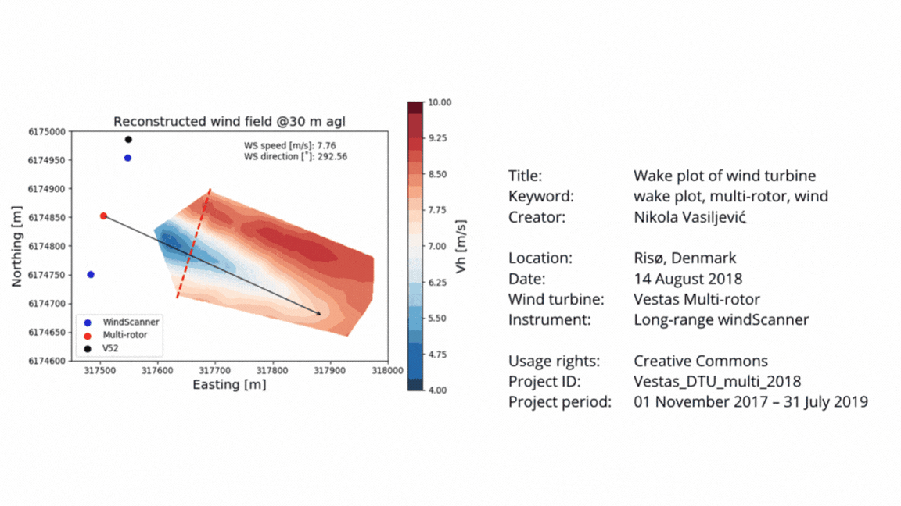

# 2b. Key Metadata Concepts 

## Metadata Knowledge Clip  

This knowledge clip created by Data Stewards from Ghent University explains more about metadata, how metadata can be generated, and where it can be found. This video will also explain four categories of metadata. We think it's useful to know that these categories exist so that you can build a more concrete idea of what qualifies as metadata. We suggest that you watch *only the first 5 minutes* of the video clip:  

<iframe
width="560"   
height="315"
src="https://www.youtube.com/embed/DW2T_cnqKPU?si=uWnerpa20dbze-ia"
align="center"
frameborder="0"
allowfullscreen
></iframe>
<br>
<p style="font-size: x-small;"><em> "Knowledge Clip: Metadata" by Ghent University Open Science is licensed under <a href="https://creativecommons.org/licenses/by/4.0/"target="_blank"> CC BY 4.0</a></em></p>
 
## Review key concepts 

Use the drop down questions to review key points from the video.


:::{dropdown} #1 What are four types of metadata? 
Four types of metadata: 
- Descriptive
- Structural
- Technical
- Administrative.  

To illustrate further, let's look at a research object and its attached metadata. This is a figure that represents wind energy with its attached metadata. The figure includes the four types of metadata.  

<p align="center">
  
</p>

 
<p style="font-size: x-small;"><em>Adapted from "Wind Energy: Metadata Type" by Deutz et al. is licensed under <a href="https://creativecommons.org/licenses/by/4.0/"target="_blank"> CC BY 4.0</a></em>, a derivative of the <a href=" https://zenodo.org/records/3712065"target="_blank"> original work</a></p>


The **descriptive metadata (the orange animation on the right side of the figure)** describes the plot for discovery and identification purposes and includes elements such as title, author, location, project period and keywords. 

The **administrative metadata (light green)** provides information to help manage the digital research object. Here, we see that it has a Creative Commons (CC) license. This means that other people are allowed to re-use the diagram. 

The **technical metadata** is shown in **purple.** In this figure we see the instrument name listed. Technical metadata could also include the file type and size of the file.  

The **structural metadata** in **blue** is the project ID since it indicates how this research object is linked to other research objects within the same project.  

(Written explanations adapted from Deutz et al, 2020)  
:::

:::{dropdown} #2: How does metadata differ from the other types of documentation?

Metadata differs from other types of documentation because it is:  

- Highly structured 

- Machine-readable 

Documentation provides fuller explanatory context, while metadata provides **structured information** for describing, finding, and supporting the reuse of research objects. 
:::

:::{dropdown} #3 Where does metadata come from? 
As you saw in the video, metadata can be generated automatically or created manually:  

Some instruments and software automatically record metadata when research objects are created or collected. For example, metadata is sometimes automatically embedded in digital outputs like photos. 

However, researchers often need to record important contextual metadata themselves, for example in a laboratory notebook, data dictionary, a template that provides suggested metadata fields, or a README file. Metadata should be created and maintained within these documentation tools throughout the project. 

When depositing a research object in a repository, you will need to complete the repository’s metadata form. (A repository is a storage platform that serves as a central location for preserving and sharing research objects, data, code, and methods so others can re-use these.) You normally provide key descriptive metadata, while the repository may add some information automatically, such as a deposit date or persistent identifier. 
:::

```{admonition} Protect sensitive metadata 
:class: warning
It's important to note that metadata may contain sensitive details that should not be publicly shared. For example, names, precise locations, dates or participant identifiers should not be exposed in public metadata records.    
```


